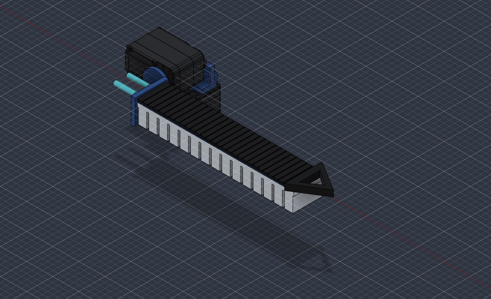
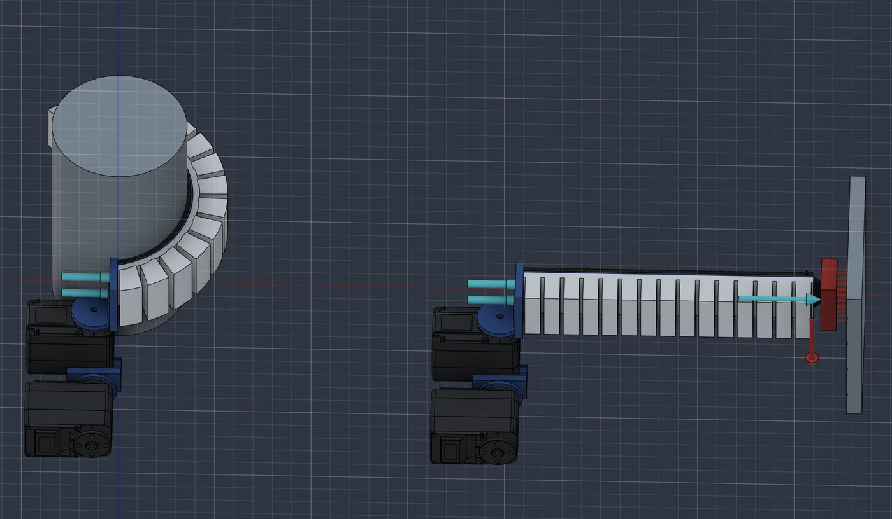
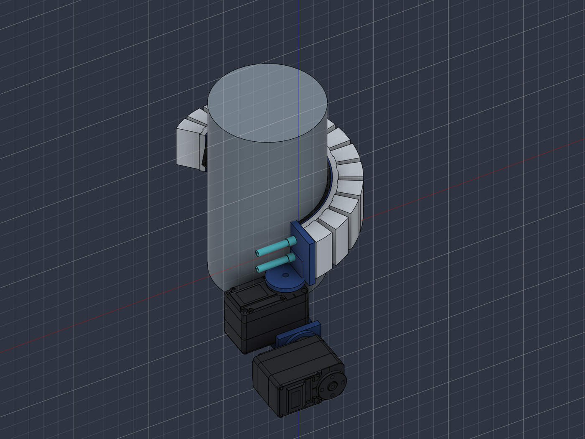
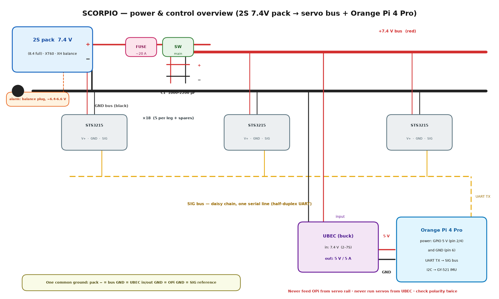
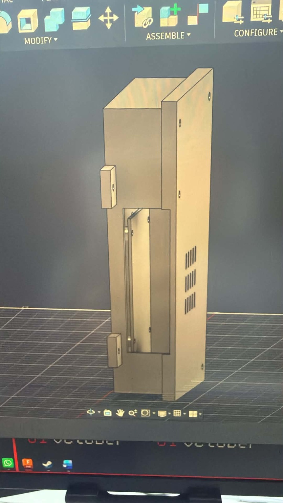
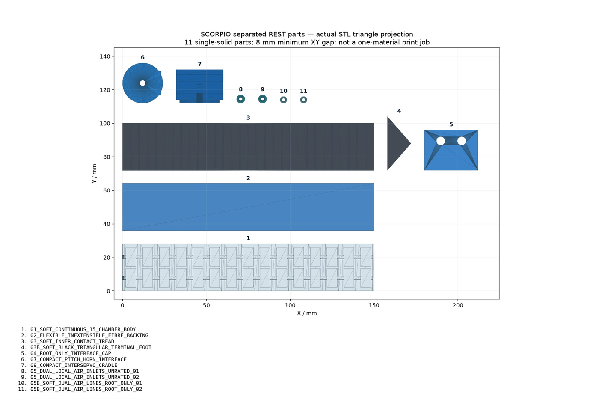

# Pseudo-Rigid Soft Robotic Spider-Type Quadruped for Tight-Space Manoeuvring

**Work in progress. Personal project. Preview only, not open source.**

This repository exists to show that the project exists and to give a quick visual and technical preview. It is not a release, not a build guide, and not a code drop. The full design, source files and control stack are not published here, and I do not intend to make this open source at present.

> **Naming note:** the project's early working name was **SCORPIO**. That name appears in older files and in the Kaggle notebook below. It is the same project.

---

## What it is

A four-legged robot whose legs are **pseudo-rigid**: each leg combines a soft, multi-chamber pneumatic body that can bend, conform and wrap, with a **rigid servo root** that carries the load and sets the leg's orientation. Concretely, the joint stays rigid and the rest of the leg is soft, so the leg can grip and wrap around geometry instead of only pushing against it.

The design target is **tight-space manoeuvring**: cluttered, confined, awkward geometry where a stiff-legged quadruped cannot get purchase, and where a fully soft limb cannot carry its own body.

<!-- IMAGE: leg concept -->

*Leg concept: rigid servo root, linear drive, and a slatted soft body along the leg axis. Concept geometry, not a validated part.*

---

## Design intent

| Element | Approach |
|---|---|
| Locomotion | Four legs, each with a rigid servo root and a soft continuum segment below it |
| Soft segment | Multi-chamber pneumatic body, with the chambers arranged so that inflation produces both bend and wrap around an object |
| Actuation at the joint | Serial-bus smart servos on a shared bus, so each leg's rigid root is independently position-controlled |
| Reinforcement | A flexible, inextensible backing layer on the outside of the soft body, so bending is controlled rather than balloon-like |
| Contact | Soft tread and a compliant terminal foot so the leg can take load on irregular surfaces |
| Compute | Single-board computer on the robot, with the real-time loop separated from the higher-level behaviour |

<!-- IMAGE: chamber array -->

*Two chamber-array layouts compared during concept work. The ring form wraps; the linear form bends in one plane.*

<!-- IMAGE: soft leg detail -->

*Soft leg concept detail: chamber body, fibre backing and inner contact tread.*

---

## Simulation and control

- **MuJoCo** is the primary simulator. Choices were made against Isaac Lab, which did not fit the available GPU memory, and Gazebo, whose contact behaviour was too soft for legged dynamics.
- An **MJCF model** is built and the **inverse kinematics has been validated against it**.
- A **standing policy** has been trained with PPO (`train_stand.py`, `eval_stand.py`, policy checkpoint). Standing is the current milestone, not a gait.
- The kinematics work is documented in a public notebook: **[SCORPIO soft-leg N=1 kinematics on Kaggle](https://www.kaggle.com/code/benjamintia/scorpio-soft-leg-n1-kinematics)**

---

## Electronics, at the level I am willing to show

- **Orange Pi 4 Pro** as the on-board computer, Ubuntu with a desktop, SSH and remote desktop access.
- **Serial-bus smart servos** on a single daisy-chained bus, sized for the rigid joint only.
- Separate **logic and servo power rails**, with the servo rail fed through a UBEC and a fused battery path.
- Battery: **3S lithium pack planned**, without a battery management system, so pack handling and cut-off are external.

<!-- IMAGE: wiring -->

*Power and communication wiring at block level. Ratings and part numbers are deliberately omitted.*

<!-- IMAGE: board housing -->

*Carrier housing for the on-board computer. This is a **test-print model**, not a physically verified fit.*

---

## Current state

| Area | Status |
|---|---|
| Leg concept | CAD concept complete for the soft leg and its rigid root; two chamber layouts compared |
| Print-ready geometry | Test-print model for the on-board computer housing only. Nothing on the robot has been printed and dry-fitted against the real hardware |
| Simulation | MJCF model, validated IK, trained standing policy |
| Electronics | On-board computer in hand and configured; servo and power hardware partially ordered |
| Physical robot | **Not built yet.** There is no walking prototype and no measured performance to report |
| Tight-space manoeuvring | A design target. No climbing or confined-space result exists yet |

<!-- IMAGE: printed-part projection -->

*The soft leg decomposed into physical parts, shown as a projection. Illustrates the part breakdown, not a validated print.*

---

## What this repository deliberately does not contain

- Native CAD and STEP sources for the leg, the body and the mechanism
- The full bill of materials, supplier part numbers and measured dimensions
- Control firmware, the gait controller and the reinforcement-learning training code
- Characterisation data: bend pressure, force, speed, fatigue, wrap performance

Those stay private while the project is in progress and unpublished.

---

## Licence and use

**All rights reserved.** No licence is granted to use, copy, modify, build from, or redistribute the contents of this repository or the designs shown in it. Images are included for preview and portfolio purposes only.

If you want to talk about the project, the design decisions, or the soft-leg approach, open an issue or reach me through my profile.
